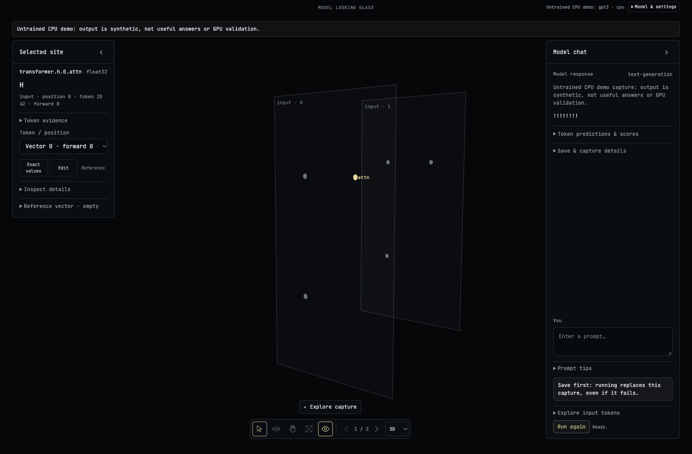

# Model Looking Glass

A local PyTorch debugger for mechanistic interpretability. Explore captured layers, inspect full activation vectors, compare prompts, and try temporary edits—without changing checkpoint files.

*Untrained CPU demo — real local UI with synthetic output.*

**[Download the app](https://github.com/EastonSell/model-looking-glass/releases/latest)** · [App guide](docs/LOCAL_APP.md) · [Discussions](https://github.com/EastonSell/model-looking-glass/discussions)

## Quick start

Download **model-looking-glass-app.zip** from the release's **Assets**, extract it, and open a terminal there. Requires **Python 3.11+**. Choose your setup:

| | NVIDIA GPU | CPU |
|---|---|---|
| Windows | `py -3 install.py --backend cuda` | `py -3 install.py --backend cpu` |
| Linux | `python3 install.py --backend cuda` | `python3 install.py --backend cpu` |
| macOS | — | `python3 install.py --backend cpu` |

CUDA needs a compatible NVIDIA GPU and driver; drivers aren't installed for you. Dependencies and checkpoints download separately. [GPU setup](docs/LOCAL_APP.md#device-selection-and-gpu-semantics).

## Open your model

After setup, launch with `python start.py` (or `py -3 start.py` on Windows). No model-size or GPU flags are needed. The automatic model preflight uses half of currently available host RAM, up to 16 GiB; automatic CUDA allowance leaves 10% VRAM or 256 MiB of headroom, whichever is larger. Explicit caps remain available for advanced use. These are storage/admission estimates, not guarantees of peak memory use.

1. Open **Model & settings** and choose your local checkpoint folder.
2. Leave device, mode and GPU allowance on **Auto**, then **Inspect folder → Load model**. Available CUDA is preferred without launch flags. GPT-2 and supported Llama open in **Chat**; other families use **Capture**.
3. In Chat, send messages without activation capture. Cached generation uses the model’s tokenizer chat template, up to 512 new tokens by default (less for small contexts), within the model and memory limits. Leave Chat’s context field blank for automatic sizing that can shrink to fit GPU memory; an explicit number is a strict request. Without a chat template, only one raw prompt is supported; choose **New chat** for another.
4. For inspection, select **Capture** under **Mode for next load**, then load again. Enter text or choose an image and **Run & capture**. Select a layer and token/patch for **Exact values**. **Reference / Edit** work on GPT-2 and supported Llama.

Chat history stays in the browser tab’s RAM and clears on reload or model replacement. The response reports context limits and any older messages omitted; context is not unlimited. CUDA Chat may use BF16/FP16 to reduce memory, with the actual dtype displayed. Outputs can differ from float32. Capture retains its float32 numerical contract. Changing modes reloads the model, clears live chat/capture state, and leaves saved files intact.

For a live GPT-2 or supported Llama capture, **Experiment** can sweep selected layer outputs, repeat tests on several prompts, and patch an explicitly selected activation between prompts. [Experiment guide](docs/LOCAL_APP.md#run-an-automated-component-sensitivity-experiment).

Compatible GPT-2, standard Llama, DistilBERT, T5 and ViT **safetensors** exports work—not every checkpoint. [Supported formats](docs/LOCAL_APP.md#checkpoint-compatibility). **Get a model** offers optional Hugging Face downloads; **Load tiny CPU demo** is an optional untrained sandbox.

Reopen with `py -3 start.py` on Windows or `python3 start.py` on Linux/macOS. Keep the folder in place and terminal open.

## Before you run

**Save captures before replacing them.** Keep the app local; exports can contain private prompts. Memory estimates aren't guarantees. Token predictions are whole-model output, not words decoded from hidden vectors.

[Contribute](CONTRIBUTING.md) · [Code map](looking_glass/README.md) · [Research & API](docs/README.md) · [Security](SECURITY.md) · [MIT license](LICENSE)
